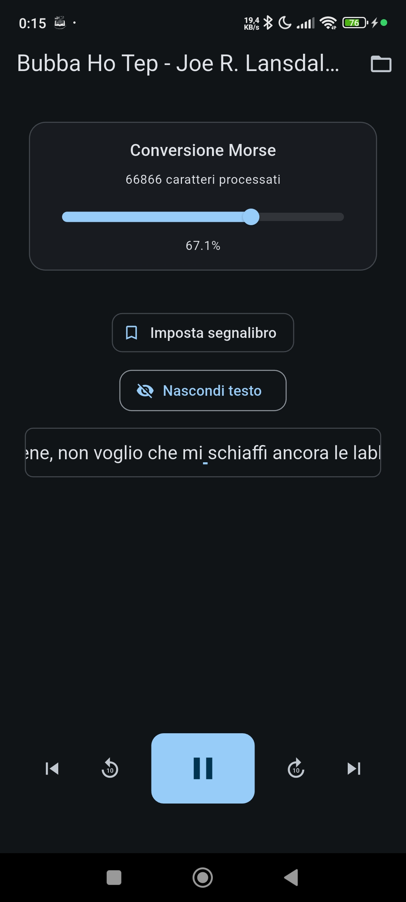
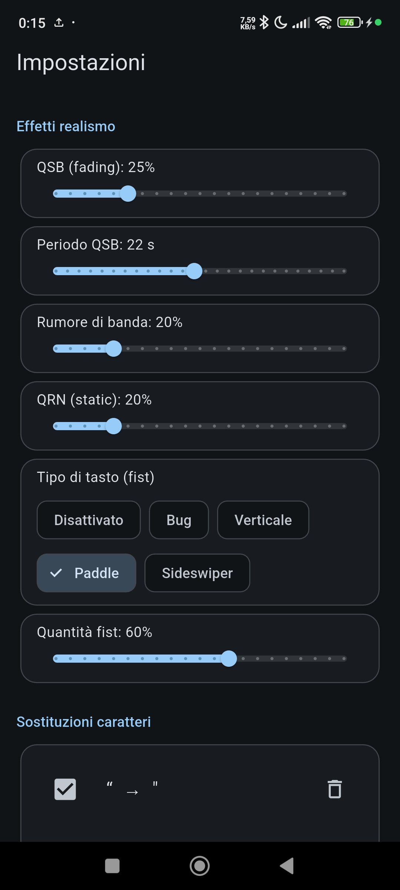

# CWReader

Convert EPUB/TXT ebooks to Morse code audio and play them back.

Read your favorite books as CW (Continuous Wave) Morse code — perfect for ham radio operators learning or practicing Morse code.

## Download

[Download latest APK](../../releases/latest) — `CWReader-release.apk`, move it on your Android device and install it. Grant the sandbox permissions to "install anyway".

## Features

- **EPUB & TXT support** — Open ebooks or plain text files
- **Morse code audio** — Sine, square, triangle, or sawtooth waveform
- **Adjustable speed** — WPM (5–60), Farnsworth spacing, extra word spacing (1x–5x)
- **Pitch control** — 400–900 Hz carrier frequency
- **Envelope (attack/release)** — Eliminates clicks at tone boundaries, adjustable 0–50 ms
- **Scrubbable progress bar** — Drag to any position in the book
- **Per-file progress** — Automatically saves last position for each file
- **Recent files** — Last 10 files with quick resume, delete entries
- **Bookmarks** — Save and restore positions per file
- **Character substitutions** — Customizable replacements (e.g. quotes, special chars), bigger UI
- **Italian accented characters** — à, è, é, ì, ò, ù mapped to standard Italian Morse codes
- **Automatic encoding detection** — UTF-8, Latin-1, Windows-1252, UTF-16 BOM
- **Wake lock** — Screen stays on while audio is playing
- **Default substitution `&` → `e`** — Automatically applied to all texts

## Video

## Screenshots

<table>
  <tr>
    <td align="center"> <em>Open file</em></td>
    <td align="center"> <em>Playback</em></td>
  </tr>
  <tr>
    <td align="center"> <em>Settings (1)</em></td>
    <td align="center"> <em>Settings (2)</em></td>
  </tr>
</table>

## Changelog

### v1.2.1
- **Wake lock**: screen stays on during playback, no more Android sleep/lock
- **Improved recent files layout**: file info arranged horizontally above the play button
- **Default substitution `&` → `e`**: automatically added to new installs and merged on existing ones
- **Internal**: `wakelock_plus` dependency, merged default substitutions on load

### v1.2.0
- Envelope (attack/release) to eliminate clicks, adjustable 0–50 ms
- Scrubbable progress bar — drag to any position
- Per-file progress auto-save and resume
- Recent files list with quick resume and delete
- Bookmarks per file
- Bigger character substitution UI
- Italian accented characters (À, È, É, Ì, Ò, Ù)

### v1.1.1
- Fix seek backward
- Fix speed not applied on first play
- EPUB HTML stripping improvements

## License

GPLv3

## Credits

Developed by **IW5DUA** (Panko74)
