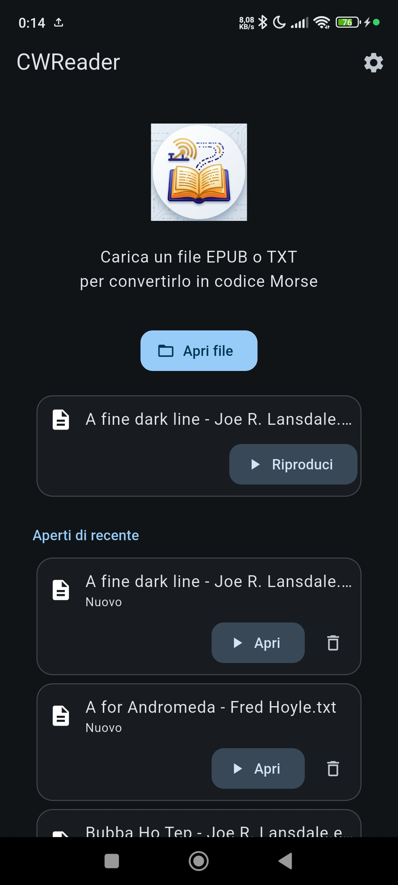
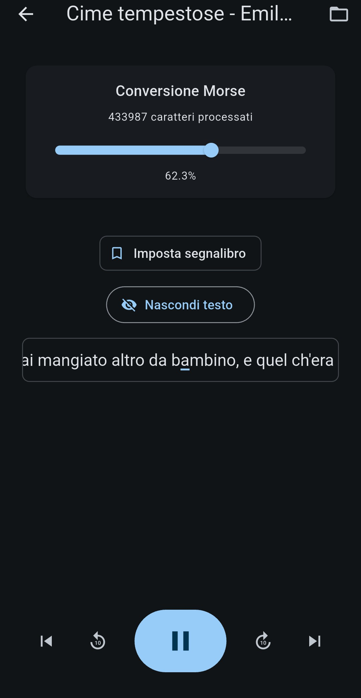
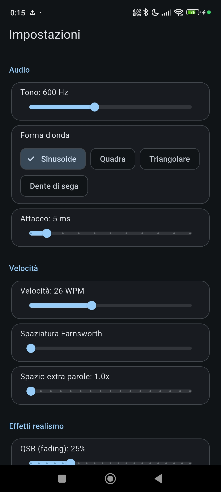
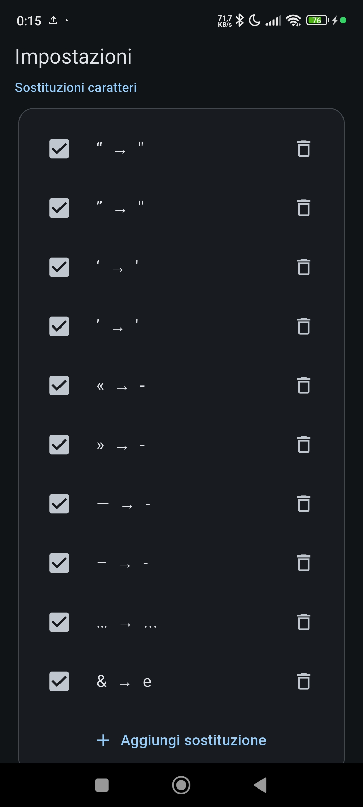

# CWReader

Convert EPUB/TXT ebooks to Morse code audio and play them back.

Read your favorite books as CW (Continuous Wave) Morse code — perfect for ham radio operators learning or practicing Morse code.

## Download

[Download latest APK](../../releases/latest) — `CWReader-release.apk`, move it on your Android device and install it. Grant the sandbox permissions to "install anyway".

## Features

- **EPUB & TXT support** — Open ebooks or plain text files
- **Morse code audio** — Sine, square, triangle, or sawtooth waveform
- **Adjustable speed** — WPM (5–60), Farnsworth spacing, extra word spacing (1x–5x)
- **Pitch control** — 400–900 Hz carrier frequency
- **Envelope (attack/release)** — Eliminates clicks at tone boundaries, adjustable 0–50 ms
- **Scrubbable progress bar** — Drag to any position in the book
- **Swipe navigation** — Swipe between book list (left), reader (center) and settings (right)
- **Realism effects** — Simulated HF propagation & keying:
  - **QSB (fading)** — adjustable depth and period (10–35 s)
  - **Band noise** — receiver noise floor, adjustable level
  - **QRN (static)** — atmospheric static crashes, adjustable level
  - **Fist** — key type simulation (*bug*, *straight key*, *paddle*, *sideswiper*) with adjustable jitter amount
- **Per-file progress** — Automatically saves last position for each file
- **Recent files** — Last 10 files with quick resume, delete entries
- **Bookmarks** — Save and restore positions per file
- **Playback with screen off** — foreground service + wake lock, keeps playing even on locked screens across devices
- **Karaoke text reader** — "Show text" button displays the text being played, scrolling with the current letter underlined
- **Accurate character counter** — advances character by character, in sync with the audio
- **Character substitutions** — Customizable replacements (e.g. quotes, special chars), bigger UI
- **Italian accented characters** — à, è, é, ì, ò, ù mapped to standard Italian Morse codes
- **Automatic encoding detection** — UTF-8, Latin-1, Windows-1252, UTF-16 BOM
- **Update check** — startup check for newer releases with a direct download link
- **Persistent book import** — opened books are copied to the app's internal storage and survive app updates; removing a recent entry also deletes its copy

## Video

## Screenshots

<table>
  <tr>
    <td align="center"> <em>Open file</em></td>
    <td align="center"> <em>Playback</em></td>
  </tr>
  <tr>
    <td align="center"> <em>Settings (1)</em></td>
    <td align="center"> <em>Settings (2)</em></td>
  </tr>
  <tr>
    <td align="center"> <em>Settings (3) — realism effects</em></td>
  </tr>
</table>

## Changelog

### v1.4.0
- **Realism effects**: QSB fading (depth + period 10–35 s), band noise and QRN static, all adjustable in real time
- **Fist simulation**: key type selector (bug, straight key, paddle, sideswiper) with adjustable jitter amount
- **Swipe navigation**: swipe between book list, reader and settings
- **GUI**: refined Material 3 theme (cards, sliders, chips, buttons)

### v1.3.0
- **Native audio player (AudioTrack)** — no more cut at the start of each chunk, continuous gapless playback
- **Playback with screen off** — foreground service + wake lock, playback keeps going on locked screens on all devices
- **Karaoke text reader** — "Show text" button shows the text being played, scrolling with the current letter underlined
- **Accurate character counter** — position advances character by character, in sync with the audio
- **Smooth seeking** — correct position even while paused; resumes from the beginning of the current word
- **Update check** — warns on startup if a newer release is available, with a direct download link
- **Persistent book import** — books are stored in the app's internal storage and survive updates; removing a recent entry also deletes its copy
- **Version shown automatically** in Settings → Info

### v1.2.1
- **Wake lock**: screen stays on during playback, no more Android sleep/lock
- **Improved recent files layout**: file info arranged horizontally above the play button
- **Default substitution `&` → `e`**: automatically added to new installs and merged on existing ones
- **Internal**: `wakelock_plus` dependency, merged default substitutions on load

### v1.2.0
- Envelope (attack/release) to eliminate clicks, adjustable 0–50 ms
- Scrubbable progress bar — drag to any position
- Per-file progress auto-save and resume
- Recent files list with quick resume and delete
- Bookmarks per file
- Bigger character substitution UI
- Italian accented characters (À, È, É, Ì, Ò, Ù)

### v1.1.1
- Fix seek backward
- Fix speed not applied on first play
- EPUB HTML stripping improvements

## License

GPLv3

## Credits

Developed by **IW5DUA** (Panko74)
